# 蒜日子

把 iPhone 行事曆裡原本的行程畫成看得清楚的月曆。iCloud、Google 的行程都算，不用註冊，也不用重記一次。

iOS 原生 app（SwiftUI），只支援 iPhone，介面是繁體中文。

<p>
  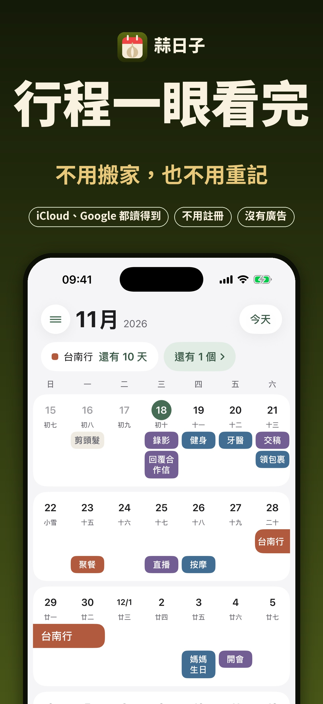
  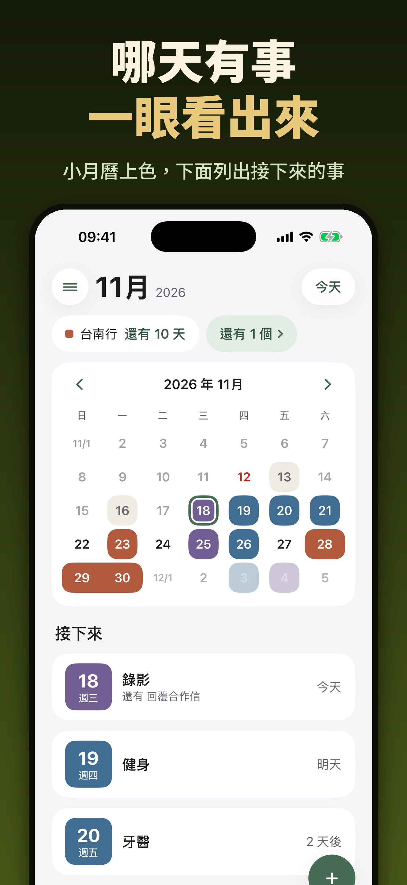
  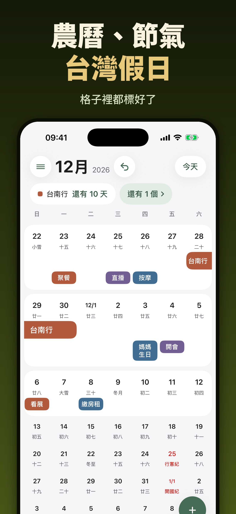
  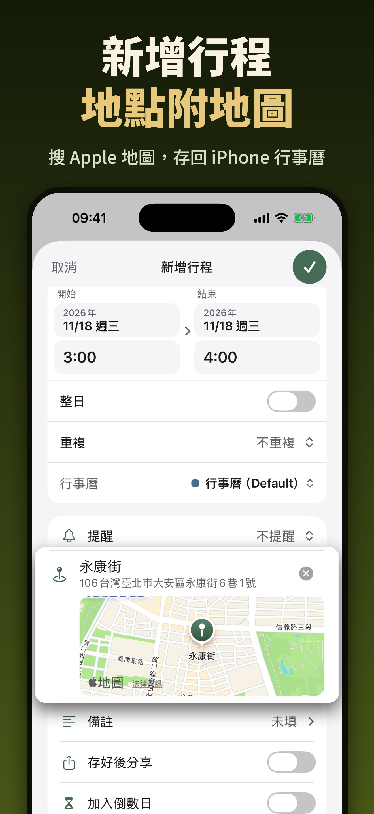
</p>

## 為什麼做這個

iPhone 內建行事曆和 Google 日曆的月檢視，在手機上一格只有 50 像素寬。行程標題被切到剩前幾個字，很多時候只是一排小點，要點進那一天才知道是什麼事。沒事的週也佔一樣的高度。

蒜日子不另外存一份行程，直接讀 iPhone 行事曆，換一種排法：每件事寫進格子裡，跨好幾天的旅行畫成一整條，沒事的週壓扁，有事的週長高。

## 看月曆的四種樣式

| 樣式 | 長什麼樣 | 免費 |
|---|---|---|
| 彈性週（預設） | 每件事都寫出來，那一週跟著長高 | 是 |
| 清單 | 小月曆用顏色標出哪天有事，下面列出接下來的行程 | 是 |
| 週條 | 沒事的日子縮窄，有事的撐開 | 完整版 |
| 主事件 | 每天只寫最重要的一件，其他用小色塊 | 完整版 |

月曆之外，側邊選單還有時間表、天、3 天、週四種檢視，看那天下午有沒有空、兩件事有沒有撞。

<p>
  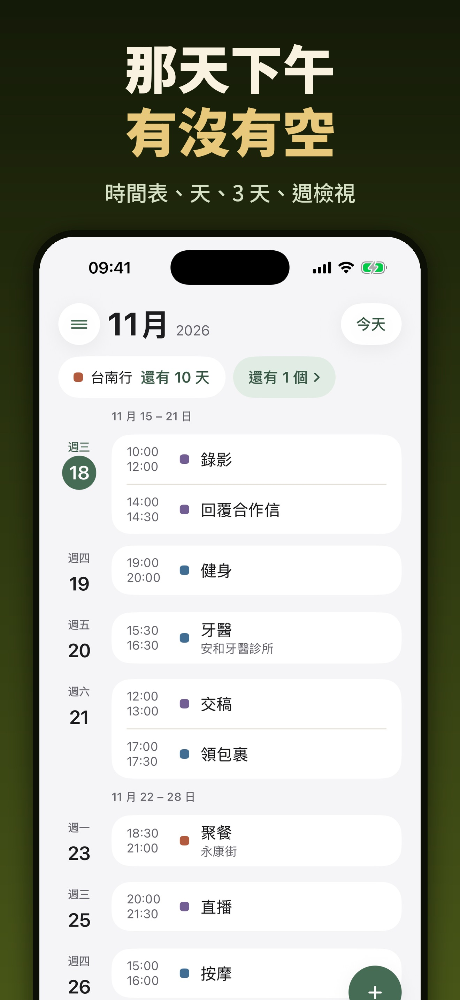
  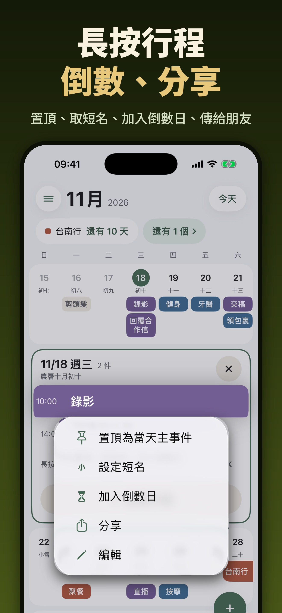
  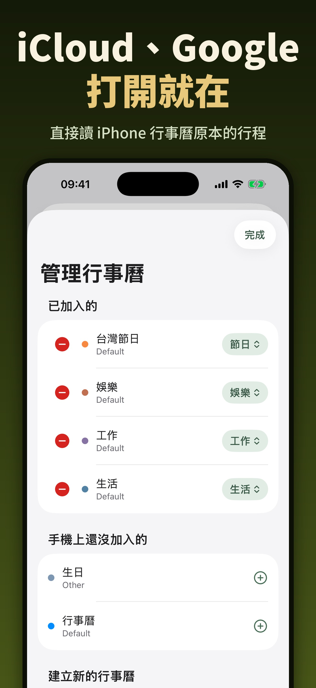
  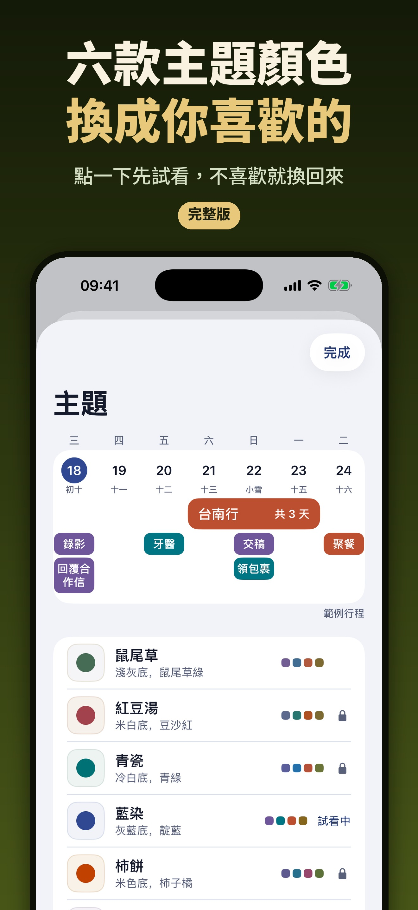
</p>

## 怎麼用

1. 第一次打開，先看一頁說明，按「繼續」，允許讀取行事曆。iPhone「設定」裡加過的 iCloud、Google 帳號，行程會一起出現。
2. 月曆打開就停在今天這一週，上下滑看前後幾週。最上面一排是倒數日。
3. 點任何一天，那天的事攤開在月曆中間，有時間、地點，開了天氣的話還有天氣。
4. 長按一筆行程，可以置頂成當天主事件、取短名（格子太窄時顯示短名）、加入倒數日、分享、編輯。
5. 右下角的＋新增行程。地點點進去搜 Apple 地圖，選好之後表單上會附一張小地圖。存進哪一本行事曆，那個帳號就看得到。
6. 左上角的選單切換時間表、天、3 天、週、月，也從這裡進設定。
7. 設定裡可以換月曆樣式、主題，管理要看哪幾本行事曆、每本對到哪個類別。

<p>
  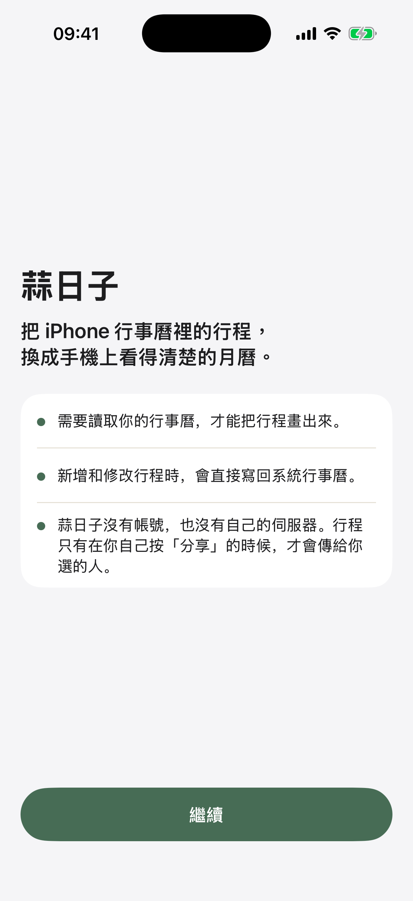
  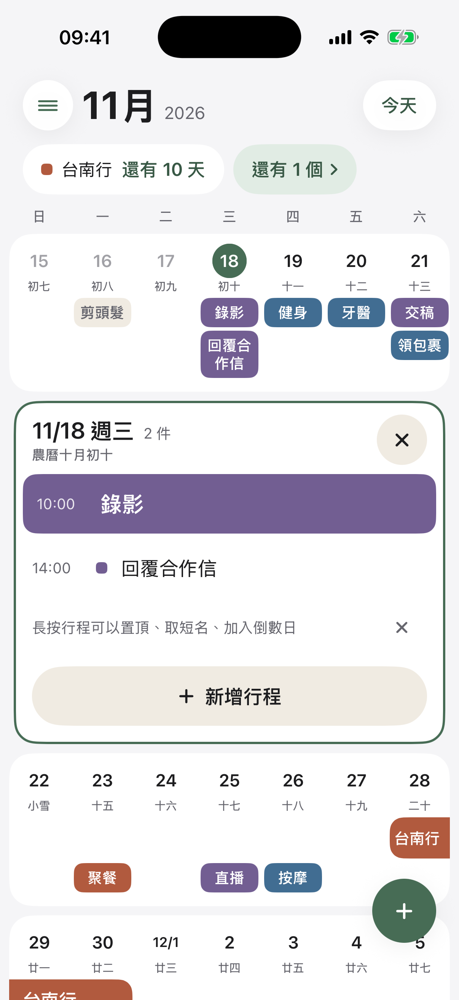
  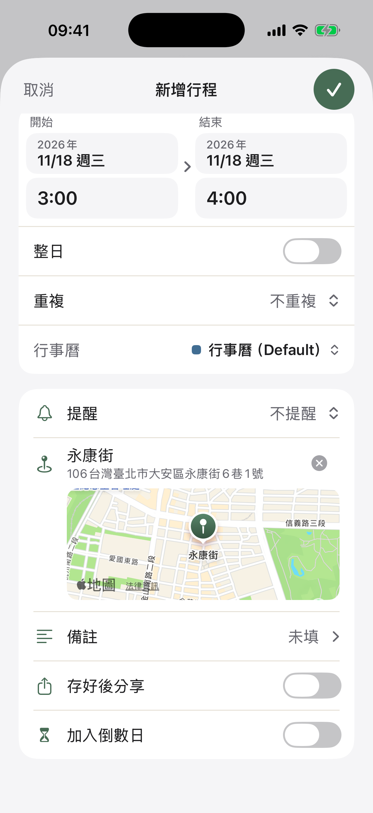
  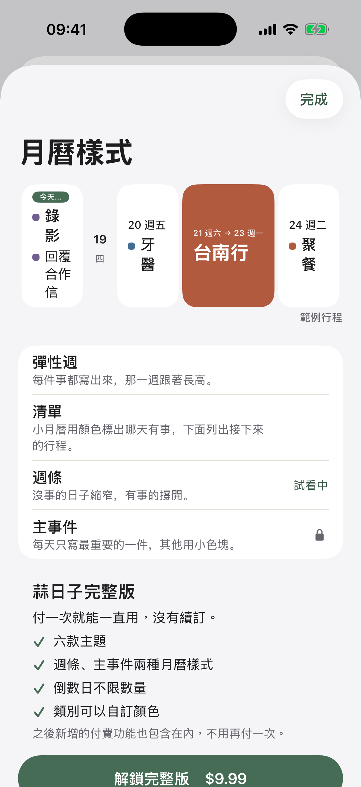
</p>

整段操作錄成了一支 4 分鐘的影片：[design/上架截圖/審核操作影片.mp4](design/上架截圖/審核操作影片.mp4)（送 App Store 審核用的那一支）。

## 功能

- 點一天：當天的事攤開在月曆中間，天氣也在這裡
- 長按行程：置頂為當天主事件、設定短名、加入倒數日、分享、編輯
- 新增行程：自己的畫面，地點搜 Apple 地圖，存好附一張小地圖。寫回 iPhone 行事曆，內建行事曆、Google 日曆那邊都看得到
- 分享：送出一段文字和「加到 Google 日曆」的連結，對方點了就能加進自己的行事曆
- 農曆、二十四節氣、台灣國定假日
- 倒數日：重要的日子放在月曆最上面
- 天氣：選了縣市，月曆和時間表上有未來十天的天氣（預設關閉，資料來自 Apple 天氣）
- 管理行事曆：選要看哪幾本、每本對到哪個類別、哪本是節日
- 類別與顏色、七款主題、深色模式、週起始日、時區、字體放大與 VoiceOver
- 主畫面「今天」小工具

## 免費與完整版

免費版就能用上面大部分功能。完整版是一次買斷的內購，沒有訂閱，也沒有廣告：

- 六款主題顏色
- 週條、主事件兩種月曆樣式
- 倒數日不限數量（免費 3 個）
- 類別可以自訂顏色

之後加的付費功能也包含在完整版裡。

## 隱私

蒜日子沒有自己的伺服器，也沒有帳號，沒有放任何分析、廣告、追蹤程式。行程從 iPhone 行事曆讀出來，就在手機上畫，不會上傳。會連網的只有：開了天氣時把縣市座標送給 Apple 天氣、新增行程時搜 Apple 地圖、購買走 App Store、你自己按分享。完整說明在 [docs/privacy.html](docs/privacy.html)。

## 專案結構

| 路徑 | 內容 |
|---|---|
| `App/` | SwiftUI 畫面、行事曆讀寫（EventKit）、購買（StoreKit 2）、天氣（WeatherKit）、設定儲存 |
| `Widget/` | 主畫面「今天」小工具 |
| `Core/` | 不依賴 iPhone 的核心邏輯（版面計算、分類、農曆、規則）和單元測試，是一個 Swift Package |
| `project.yml` | XcodeGen 的專案描述，雲端建置時產生 Xcode 專案 |
| `docs/SPEC.md` | 完整規格 |
| `docs/privacy.html` | 隱私權政策頁 |
| `design/` | 設計稿、方案比較的 HTML、上架截圖 |
| `.aso/` | App Store 上架文案、關鍵字、截圖腳本 |
| `.vibe/`、`.uiux/` | 開發過程的切片帳本、設計審查紀錄 |

## 怎麼建置

開發機是 Windows，沒有 Mac，所以編譯全部在雲端：

- **GitHub Actions**（`.github/workflows/build.yml`）：每個 PR 跑核心邏輯測試（`swift test --package-path Core`），再編譯一次模擬器版本
- **TestFlight**（`.github/workflows/testflight.yml`）：手動觸發，簽章後上傳。需要的 App Store Connect 金鑰放在 repo 的 Secrets
- **實機畫面**：用 limrun 的遠端 Xcode 與 iOS 模擬器跑。上架截圖就是這樣拍的：

```bash
lim xcode build . --xcodegen-spec project.yml --scheme SuanRiZi --ios --create --quiet
```

在 Mac 上要自己建置的話：

```bash
brew install xcodegen
xcodegen generate
open SuanRiZi.xcodeproj
```

### 示範行程

Debug 建置有一段示範資料（`App/Support/DemoSeeder.swift`），上架版本不會包含。給了行事曆權限之後，用環境變數 `SUANRIZI_DEMO=1` 啟動，會在「本機」建工作、生活、娛樂、台灣節日四本行事曆，排今天前後三週的假行程。截圖和審核影片都用它，不會拍到真實的行事曆。
